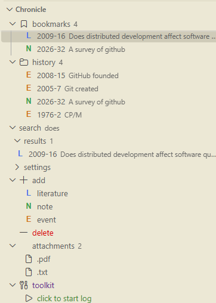
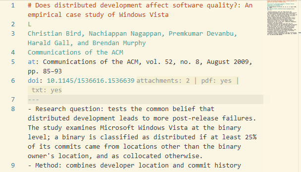
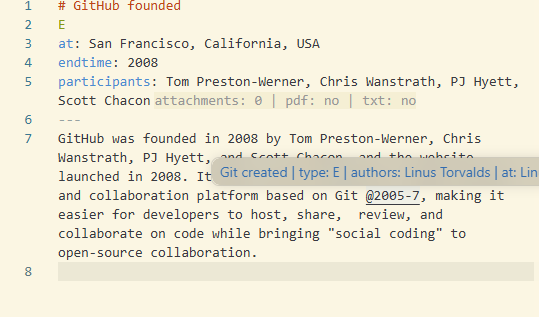
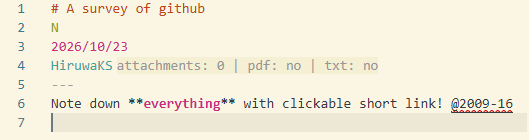

# Chron

Read and write your personal chronicle inside VS Code. Current doc, bookmarks, history, attachments: one screen away.

Config: set `chron.notesPath` to your notes repo. Legacy `vsextchronicle.notesPath` still works.

Features: add literature, notes, and events; bookmarks; history; metadata search; `@docid` links and reverse refs; open attachments and copy paths; delete to trash; logging toggle.

